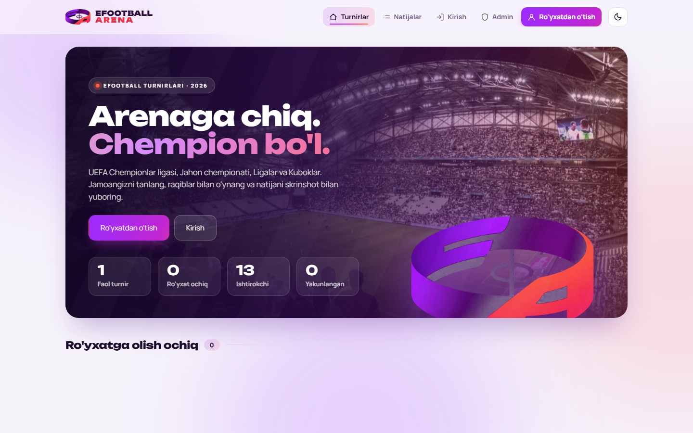

<div align="center">


# eFootball Arena

**eFootball turnirlarini o'tkazish uchun to'liq platforma: ro'yxatdan o'tish, jadvallar, pley-off, dedlaynlar va admin paneli.**

*A full-featured eFootball tournament platform: UCL-style league phase, World Cup groups, leagues and cups.*

[](https://efootballarena.uz)


</div>

<p align="center">
  <a href="https://efootballarena.uz"></a>
</p>

## Imkoniyatlar

| | |
|---|---|
| 🏆 **4 xil turnir** | UEFA yangi formati (liga bosqichi + 9–24 pley-off), Jahon chempionati (guruhlar + pley-off), Liga (1 yoki 2 aylana), Kubok |
| ⚽ **100 ta jamoa** | 50 ta klub (haqiqiy logotiplar) va 50 ta terma jamoa. Bitta turnirda har bir jamoani faqat bitta o'yinchi tanlaydi |
| 👥 **Cheksiz ishtirokchi** | "Logosiz" turnirlar 10 000+ o'yinchini ko'taradi: sahifalash, qidiruv va keshlash bilan |
| 📸 **Natija + skrinshot** | O'yinchilar hisobni skrinshot bilan kiritadi va 3 martagacha tahrirlaydi. Raqib noto'g'ri hisob haqida shikoyat qila oladi |
| ⏱ **Dedlaynlar** | Turlar ketma-ket ochiladi. Natija kiritilmasa, avtomatik 0:0 qo'yiladi; pley-offda ikkala o'yinchi ham chiqib ketadi |
| 🟨🟥 **Kartochkalar** | 2 ta sariq qizilga aylanadi. Qizil kartochka keyingi o'yinda 0:3 texnik mag'lubiyat beradi |
| 🛡 **Admin huquqlari** | Asosiy admin boshqa adminlarga 11 ta huquqni alohida yoqib-o'chiradi |
| 🌗 **Dizayn** | Qorong'i va yorug' mavzu, animatsiyalar, telefon, planshet va katta ekranlarga moslashgan |

## Texnologiyalar

- **Backend:** Python standart kutubxonasi (`http.server`, `ThreadingHTTPServer`), tashqi kutubxonasiz
- **Ma'lumotlar bazasi:** JSON fayl: atomik yozish, fonda saqlash, versiyalangan kesh
- **Xavfsizlik:** PBKDF2 parol xeshlash, HttpOnly/SameSite cookie sessiyalari, rollar va huquqlar tizimi
- **Frontend:** Vanilla JavaScript SPA (hash-routing), CSS o'zgaruvchilari bilan mavzular
- **Deploy:** Ubuntu VPS, systemd, Caddy (avtomatik HTTPS), har kuni zaxira nusxa

## Ishga tushirish

Faqat **Python 3.9+** kerak.

```bash
git clone https://github.com/alisherboltaev/efootball-arena.git
cd efootball-arena
python server.py
```

Keyin brauzerda http://localhost:8000 manzilini oching. Windows'da `start.bat` faylini ikki marta bosish ham kifoya.

### Asosiy admin

- Admin panel: saytdagi **Admin** tugmasi (`#/admin/login`)
- Login: `admin`
- Parol birinchi ishga tushishda tasodifiy yaratiladi va server konsolida bir marta ko'rsatiladi (`Asosiy admin yaratildi: ...`).

O'z login va parolingiz bilan boshlash uchun birinchi ishga tushirishdan oldin `ADMIN_LOGIN` va `ADMIN_PASSWORD` muhit o'zgaruvchilarini o'rnating. Kirgandan keyin parolni **Admin panel → Sozlamalar** bo'limida almashtiring.

| O'zgaruvchi | Standart | Vazifasi |
|---|---|---|
| `HOST` | `0.0.0.0` | Server tinglaydigan manzil |
| `PORT` | `8000` | Port |
| `ADMIN_LOGIN` | `admin` | Birinchi asosiy admin logini |
| `ADMIN_PASSWORD` | tasodifiy | Birinchi asosiy admin paroli |

## Turnir qoidalari

- **UEFA (yangi format):** hamma bitta jadvalda o'ynaydi, har bir jamoaning o'yinlar soni sozlanadi (standart 8 ta). 1–8-o'rinlar to'g'ridan-to'g'ri 1/8 finalga chiqadi. 9–24-o'rinlar tasodifiy juftlarda ikki o'yinli pley-off o'ynaydi. 25-o'rindan pastdagilar chiqib ketadi.
- **Jahon chempionati:** guruh bosqichi, keyin pley-off.
- **Liga:** 1 yoki 2 aylana (masalan, 20 ishtirokchi va 2 aylana bo'lsa 38 tur bo'ladi).
- **Kubok:** faqat pley-off.

## Loyiha tuzilishi

```
server.py          # butun backend: API, turnir mantiqi, sessiyalar
teams.py           # 50 ta klub va 50 ta terma jamoa
static/
  index.html       # SPA qobig'i
  app.js           # barcha sahifalar va UI
  style.css        # mavzular va moslashuvchan dizayn
  logos/           # klub logotiplari
  img/             # logotip, stadion suratlari
deploy/            # Caddyfile va systemd xizmati
DEPLOY.md          # VPS'ga joylash bo'yicha qo'llanma
```

`data/` papkasi (ma'lumotlar bazasi va yuklangan rasmlar) repozitoriyga kirmaydi.

## Internetga joylash

Batafsil qo'llanma: [DEPLOY.md](DEPLOY.md). Unda Ubuntu VPS, domen, Caddy orqali HTTPS, systemd xizmati va har kungi zaxira nusxa sozlanishi yozilgan.

## Rasmlar

Stadion va futbol suratlari Openverse orqali olingan va CC0 / public domain litsenziyasida (rawpixel, StockSnap).

---

<div align="center">

Muallif: **Alisher Boltaev** · [Telegram](https://t.me/Alisher_Boltaev) · [Instagram](https://www.instagram.com/alisherboltaev_/)

</div>
